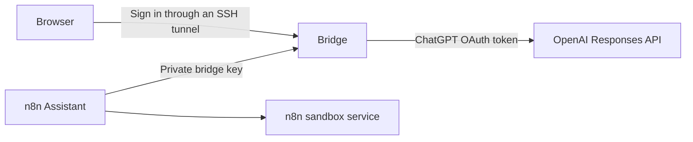

# ChatGPT plan connection for n8n Assistant

This experimental bridge connects a self-hosted n8n Assistant to a user's ChatGPT plan. It uses OpenAI's documented OAuth flow. It does not use a paid OpenAI API key.

The bridge runs beside n8n. The supplied stack runs stock n8n 2.42.6. It does not require a full n8n monorepo build. The bridge source and deployment configuration live in this fork.

## Request path



OpenAI documents this flow for eligible open-source or locally hosted applications. OpenAI’s September 29, 2026 release documents this app capability for eligible Plus and Pro users. Free-account access is not documented for this flow. Account, workspace, integration, and model eligibility still apply. See the [official release details](https://learn.chatgpt.com/docs/whats-new/devday-2026). Plan usage limits apply. This does not grant unlimited API access. A completed live inference request is required to verify access.

## Start on a Linux VM

1. Use Node 24 or later and Docker Compose.
2. Copy `.env.example` to a private directory outside the fork.
3. Generate a distinct random value for each secret. Keep the environment file private.
4. Create `CHATGPT_AUTH_DIR`. Set its owner to UID 1000. Set its mode to `0700`.
5. Set `N8N_BIND_IP` to a private address. The default is loopback.
6. Start the stack from this directory:

```sh
docker compose --env-file /absolute/private/path/stack.env up -d --build
docker compose --env-file /absolute/private/path/stack.env ps
```

The Compose project has its own SQLite database and Docker volumes. It does not use another project's database or ports. The sandbox runner uses privileged Docker-in-Docker. Its ports are not published. OAuth credentials are mounted only into the bridge.

The supplied configuration uses HTTP for a private development instance. For an internet deployment, add TLS and restore secure cookies. n8n recommends a managed sandbox for production.

## Connect the ChatGPT account

First open n8n and create its owner account. Owner setup and ChatGPT authorization are separate. The stack preconfigures the Assistant endpoint at startup, but it cannot use ChatGPT until OAuth completes.

This prototype has one connection for the entire n8n instance. Users who can access its Assistant share that connection’s plan usage. Only the operator should access the loopback connection page through SSH. It is not per-user OAuth inside n8n settings.

OpenAI requires an HTTP loopback callback. A browser on another computer cannot reach the VM's loopback listener without a tunnel.

1. Open an SSH tunnel from the computer that runs your browser:

```sh
ssh -N -L 1455:127.0.0.1:1455 user@vm-address
```

2. Open `http://127.0.0.1:1455` in that browser.
3. Select **Continue with ChatGPT**.
4. Complete OpenAI sign-in and approve ChatGPT plan access.
5. Select an available model in the returned page.
6. Return to n8n Assistant. Send a small request. Review any generated workflow.

The bridge creates a stable host ID before sign-in. Initial registration uses `dynamic_agent_client`. It saves the issued client ID for later sign-in and token renewal. It validates the ID token signature, issuer, audience, expiry, and nonce. It checks the granted ChatGPT plan scope.

Credentials use atomic writes and owner-only permissions. The single bridge process serializes rotating refresh tokens. Do not run two bridge processes against the same credential directory. Do not copy this credential directory into a repository or image.

## n8n configuration

The stack sets these variables:

```ini
N8N_INSTANCE_AI_MODEL=openai/chatgpt-plan
N8N_INSTANCE_AI_MODEL_URL=http://chatgpt-bridge:3210/v1
N8N_INSTANCE_AI_MODEL_API_KEY=<private bridge key>
```

Use the environment configuration. n8n can treat a custom URL selected through its settings UI as a Chat Completions endpoint. This bridge implements Responses, not Chat Completions. Workflow OpenAI nodes that need other endpoints are outside this integration's scope.

The bridge sends inference only to `https://api.openai.com/v1/responses`. It does not use ChatGPT web backend endpoints or copy another application's OAuth client ID.

## Compatibility behavior

- Send `store: false` and `stream: true` upstream.
- Convert system message items to developer message items.
- Retain full history. Reject stored conversation IDs.
- Retain encrypted reasoning content for later turns.
- Remove fields that the ChatGPT plan route does not support.
- Group local function tools in an `n8n` namespace.
- Preserve tool-call output and namespace across turns.
- Collect a completed SSE response for n8n's non-streaming setup probe.
- Return account errors and plan limits. Never fall back to billable API authentication.
- Choose models from the signed-in account's catalog.

If code exchange returns `invalid_grant`, the bridge retains the issued client ID in memory for a fresh authorization with new state and PKCE values. It never reuses the failed code. Repeated failures need investigation; a browser sign-in alone does not prove a saved connection or eligible inference. Safe status diagnostics are available at `/auth/status`. Redacted code-exchange diagnostics are written only inside the private credential directory.

The admin page supports one ChatGPT account per deployment. Reconnection retains that account's issued registration. To revoke access, disconnect the app in ChatGPT Settings. Stop the bridge before removing its local credential file.

## Verify changes

Run these checks on the VM:

```sh
corepack pnpm install --ignore-workspace --frozen-lockfile
corepack pnpm exec prettier --check src test eslint.config.mjs package.json README.md compose.yml
corepack pnpm exec eslint src test eslint.config.mjs
corepack pnpm exec vitest run test/bridge.test.mjs --maxWorkers=1
```

The tests use isolated temporary directories and mocked inference. They cover request adaptation, completed streams, OAuth state, JWT validation, credential permissions, refresh rotation, origin checks, and usage limits. They do not prove that a real account is eligible.

With the Compose stack running, also exercise the actual n8n image’s model factory and installed AI SDK:

```sh
sh test/run-n8n-sdk-smoke.sh
```

This starts a temporary mock bridge on the Compose network. It checks the non-streaming setup probe and a streamed function call, execution, and continuation through n8n’s own SDK. The mock validates `store: false`, `stream: true`, unsupported-field removal, OAuth bearer isolation, namespaced tools, and full tool history. It makes no OpenAI requests and stops its temporary container afterward.

Local verification: 18 unit tests, lint, formatting, the real n8n SDK smoke test, and container health checks passed. Live verification is incomplete: a Free-account sign-in returned `invalid_grant` during code exchange and no OAuth credentials were saved. Confirm eligibility and complete a real Responses request before relying on this integration.

## Primary references

- [n8n Assistant setup](https://docs.n8n.io/deploy/host-n8n/configure-n8n/set-up-n8n-assistant/)
- [OpenAI open-source OAuth registration](https://developers.openai.com/siwc/token-sharing-open-source/sign-in)
- [ChatGPT plan models and inference](https://developers.openai.com/siwc/token-sharing-open-source/models-and-inference)
- [Preview requirements](https://developers.openai.com/siwc/token-sharing-open-source/preview-limitations)
- [Token renewal](https://developers.openai.com/siwc/token-sharing-open-source/profiles-and-sessions)
- [Self-hosted VM guidance](https://developers.openai.com/siwc/token-sharing-open-source/self-hosted-vms)
